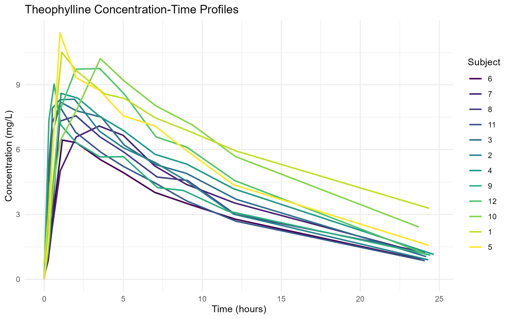

# Week 01: Theophylline Pharmacokinetic Data Analysis

## Objective
Explore concentration–time profiles and calculate basic pharmacokinetic parameters using R.

## Dataset
- **Dataset:** `Theoph` (built-in R dataset)
- **Drug:** Theophylline
- **Subjects:** 12
- **Observations:** 132
- **Variables:** Subject, body weight, dose, time, and plasma concentration.

## Analysis Performed

1. Inspected the dataset using `head()`, `str()`, and `summary()`.
2. Plotted individual concentration–time profiles using `ggplot2`.
3. Created a log10 concentration plot to examine the profiles across a logarithmic scale.
4. Calculated individual:
   - Maximum observed concentration (Cmax)
   - Time of maximum observed concentration (Tmax)
5. Converted dose from mg/kg to total dose in mg using body weight.
6. Calculated dose-normalised Cmax.

## Key Findings

- Subject 10 had the latest observed Tmax: **3.55 hours**.
- Subject 5 had the highest observed Cmax: **11.4 mg/L**.
- Subject 5 also had the highest dose-normalised Cmax: **0.0356 L⁻¹**.

## R Packages Used
- `dplyr`
- `ggplot2`

## Skills Practiced
- Data inspection and manipulation
- Grouping and summarizing data
- Data visualization
- Basic pharmacokinetic parameter calculations
- Using pipes (`%>%`) and data transformation workflows

## Important Note
This is an exploratory analysis of observed concentration data. Cmax and Tmax are calculated from sampled observations and may not represent the true underlying peak concentration or time.

## Figures

### Linear Scale

### Log10 Scale
